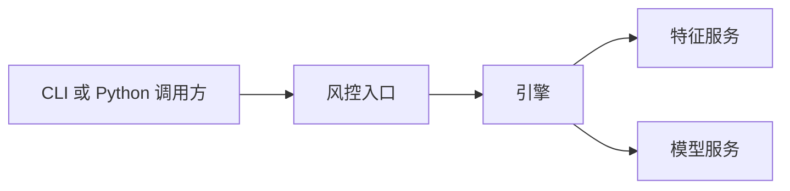

# 风控链路模拟项目设计

## 需求目标

| 编号 | 从原文提炼的目标 | 验收结果 |
| --- | --- | --- |
| R1 | 用 Python 复现风控入口、引擎、特征、模型四层交互 | 进程内调用，可通过命令行和 Python API 运行。引擎统一编排，模型仅消费特征向量 |
| R2 | 用配置描述场景、特征、规则和模型 | 四类 JSON 配置可独立查阅。修改阈值即可改变对应决策，引用错误在加载时报告 |
| R3 | 复现授信、下单、定价样例 | 分别得到 PASS（30000、12 期）、ALLOW（4999、免验证）、PRICE_OK（利率 15%、APR 16.2%） |
| R4 | 展示高风险、缺失、超时、版本错误和参数错误 | 有确定的故障触发方式、业务动作与原因码。补取至多一次 |
| R5 | 用统一契约追踪调用链 | trace_id 贯穿成功、拒绝和降级请求。可查看规则命中、模型结果、特征来源、版本、缺失及耗时 |
| R6 | 交付可复验的演示 | 附样例、测试方案、自动化测试、验证记录和启动说明。Python 3.11+ 标准库即可运行 |

原文是设计参考。本次交付包含可运行源码。客户、设备、商户、额度和模型参数均为演示数据。订单放行金额是建议占用额度，本项目范围为同步模拟决策。

## 接口与调用关系

| 接口 | 请求 | 响应 |
| --- | --- | --- |
| 风控 | scene、request_id、customer_id、product_code、amount 或场景金额别名、term_months、场景实体键。可选 trace_id、request_time、timeout_ms 和场景业务参数 | code、message、decision、approved_amount、approved_term、final_rate、apr、need_verify、risk_level、reason_codes、trace_id、component_results |
| 引擎 | trace_id、scene、strategy_id、business_context、entity_keys、timeout_ms | decision、reason_codes、hit_rules、model_result、feature_snapshot、component_trace、next_action、output |
| 特征 | trace_id、scene、entity_keys、feature_set_id、feature_names、required_flags、as_of、timeout_ms，以及显式配置为请求来源的业务字段 | feature_values、feature_meta、missing_features、feature_version、ttl、latency_ms、status |
| 模型 | trace_id、scene、model_code、model_version、feature_version_used、feature_vector、feature_meta、business_context、threshold_profile、timeout_ms | score、probability、risk_level、threshold、decision_hint、missing_features、model_version、feature_version_used、latency_ms、status |

入口将金额归一为正数，校验别名一致性，校验正整数期数、比例及超时预算。授信需 apply_id 和 device_id，下单需 order_id、device_id 和 merchant_id，定价需 pricing_id、application_id 和 base_rate。客户、申请、订单、设备等 ID 只作为实体键，业务上下文使用显式白名单。无时区的 request_time 按 UTC 处理，省略则取 UTC 当前时间。CLI 对 JSON 对象返回标准风控响应，业务拒绝或降级退出码为 0，参数错误为 2。

## 特征、规则与模型编排

1. 引擎按场景配置批量获取特征。可用额度来自 Mock 客户快照，下单请求中的 available_credit 只作输入校验。期限和竞品利率由已配置的请求来源提供。模拟快照时间为 as_of 前 60 秒，默认 TTL 为 300 秒。缺失、错误类型或过期在元数据中可追溯。
2. 引擎对非关键特征应用配置默认值，并保留原始缺失原因。规则只读取当次上下文。引擎先校验快照版本，随后按配置顺序收集所有可执行的规则命中，决策取第一个硬规则命中。若关键规则依赖缺失且无硬规则命中，直接按场景降级。
3. 引擎只传给模型配置要求的特征及对应元数据。模型校验类型和版本。模型报告缺项时，引擎只补取这些项一次，更新快照，复查规则及依赖，再按同一预算重试模型。持续缺失或回补超时都产生可解释降级。
4. 模型使用配置的线性计算和阈值，结果限制在 0 到 1 内。授信高分通过，低分转人工。下单低欺诈概率放行，达到阈值时验证。定价根据模拟溢价和配置上下限计算，低风险定价允许匹配报价区间内、比拟定利率最多低 0.5 个百分点的有效竞品价。匹配只使用未默认的竞品价，追加 COMPETITOR_RATE_MATCHED。APR 采用演示公式 `final_rate + 0.012`，两个字段均以小数比例表示。
5. 同一请求使用一个模拟预算。特征批取、补取各耗 5 ms，模型调用耗 8 ms。超时消耗剩余预算，演示故障注入也使用该机制。耗时是逻辑时间，演示无需真实等待。响应内保留有序事件，CLI 启用 --audit 时将事件写入 stderr，决策 JSON 写入 stdout。

## 决策与降级

| 触发条件 | 授信 | 下单 | 定价 | 原因码 |
| --- | --- | --- | --- | --- |
| 硬规则命中 | REJECT | 依规则 REJECT 或 CHALLENGE | 依规则配置 | 规则对应原因码 |
| 模型不满足通过条件 | REVIEW | CHALLENGE | PRICE_OK，按溢价与价格区间计算 | CREDIT_SCORE_BELOW_THRESHOLD / ORDER_MODEL_CHALLENGE / 定价原因 |
| 特征超时且缺少必要数据 | REVIEW | CHALLENGE | REVIEW | FEATURE_TIMEOUT_FALLBACK |
| 缺少规则依赖 | REVIEW | CHALLENGE | REVIEW | FEATURE_MISSING |
| 模型报告缺项且补取后仍无法预测 | REVIEW | CHALLENGE | REVIEW | MODEL_MISSING_FEATURE |
| 特征版本不匹配 | REVIEW | CHALLENGE | REVIEW | FEATURE_VERSION_MISMATCH |
| 模型超时 | REVIEW | CHALLENGE，保留规则结果和验证要求 | REVIEW | MODEL_TIMEOUT_REVIEW / MODEL_TIMEOUT_RULE_ONLY |
| 入口校验失败 | INVALID | INVALID | INVALID | PARAM_INVALID |

有默认值的特征缺失时允许继续推理，并保留 FEATURE_MISSING 与来源标记。补取成功仍保留 MODEL_MISSING_FEATURE，表示链路发生过恢复。业务字段仅在相应动作下赋值。风险等级来自成功的模型预测。CHALLENGE 的 need_verify 为 true，ALLOW 为 false，其他场景为 null。

## 演示配置

场景配置绑定策略、特征集、模型、规则与输出语义。特征配置声明来源、类型、关键性、版本和 TTL。模型配置声明版本、输入、线性权重和阈值。规则配置使用有限的比较操作与求和操作，规则按列表顺序执行。CLI 的故障注入独立于业务请求，覆盖首次缺失、持续缺失、过期、版本不匹配和超时。
