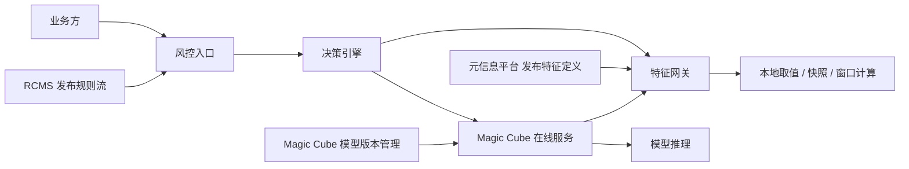

# 三平台与在线决策

## 从需求到实现

| 平台 | 配置职责 | 在线执行 |
| --- | --- | --- |
| RCMS | 管理场景规则流版本，配置反洗钱、业务规则和反欺诈步骤的顺序 | 入口选择已发布规则流。规则命中时按配置返回拦截、验证或人工复核 |
| 元信息平台 | 发布数据源、业务域、实体键、字段类型、特征定义和特征集版本 | 特征网关按业务域与获取方式批量分发，合并数值、来源和缺项 |
| Magic Cube | 注册、校验、部署、下线模型版本，可重新部署旧版本 | 在线接口按活动版本向特征平台取数、校验口径、有限回补并执行推理 |

特征设计依据参考文档的 §1.2、§1.3、§2.2、§3.3–3.4，涵盖模型主动取特征、元信息与计算定义分离、按业务域路由、同步计算、快照读取及强弱依赖降级。演示使用合成数据与进程内组件。参考 PDF 保存在仓库原路径，交付 ZIP 只包含项目和合成样例。 [特征系统运维分享](https://github.com/wck-wei/risk-demo/blob/547994b/doc.pdf)

| PDF 组件或概念 | 演示对应 |
| --- | --- |
| 特征 console 与元数据接口 | 元信息平台发布数据源目录及特征定义，供服务加载 |
| feature-gate 与域服务 | 特征网关按定义中的业务域和路由拆分批次并汇总 |
| feature-cal-server、特征快照 | 合成订单的同步窗口计算及客户快照读取 |
| data-report | 可去重的合成订单上报，供后续窗口计算 |

## 调用链



规则流默认依次评估合规、业务和反欺诈节点。硬命中进入相应业务动作。未命中且必需数据不全时使用场景降级，规则通过后才调用模型。定价对竞品价的采纳继续由引擎处理。合规复核是合成名单筛查命中的后续动作。

引擎与 Magic Cube 共用一次请求的预算、时间点和元信息发布版本。模型在线接口接收实体和业务上下文，通过特征网关查自己的输入，将向量交给推理组件。缺项仅补取一次。保留首次缺失、恢复、超时和最终决定的审计轨迹。

## 发布与演示

环境以 JSON 配置和进程内发布登记为基础。通过重建服务加载新配置，通过 Magic Cube 的接口演示注册、校验、部署、回滚和下线。数据源使用固定快照、请求字段及合成事件流，日期以请求的 as_of 为准。项目维持授信、下单和定价的原有基准输出。

### 配置规则流和特征口径

- 在 `risk_demo/config/scenes.json` 配置 `strategy_id`、`flow_version`、`rule_stages`，在 `rules.json` 把规则归入对应阶段并配置比较条件及命中动作。新建 `RiskService` 加载并选择发布版本。演示中的「切换规则流版本」按新顺序评估同一笔订单。
- 在 `metadata.json` 声明数据源的业务域、实体键及获取路由。通过 `features.json` 引用数据源，并指定特征类型、关键性、默认值、TTL 和计算窗口。更改元信息时更新发布版本，再重建服务生效。
- `LOCAL` 读取请求上下文或进程内数据，`TABLE` 读取合成快照，`OUTER_API` 路由到进程内的订单窗口计算。读取与计算共享特征定义。条件为 `0 < as_of - occurred_at <= window`，避免把当前订单或未来订单算入历史金额。

### 使用模型生命周期与订单上报接口

以下示例运行在项目根目录，状态保留在该个服务实例内。

```python
from datetime import datetime
from risk_demo.risk import RiskService

service = RiskService()
cube = service.magic_cube
model = "CREDIT_SCORE_V1"
cube.register(model, "2.0", {"threshold": 0.84})
cube.validate(model, "2.0")
cube.deploy(model, "2.0")
assert cube.versions(model)["2.0"] == "DEPLOYED"

cube.deploy(model, "1.0")
cube.retire(model, "2.0")

service.feature_service.report_order(
    "CUST1001", "DEMO-ORDER-REPORT", 9000,
    datetime.fromisoformat("2026-05-29T10:00:00+00:00"),
)
```

部署新版本后，旧版本可重新部署。撤回活动模型可使用 `undeploy`，该在线接口随后按场景进入备用流程。正在使用的模型版本须先撤回或切换，才可作永久下线处理。模型切换对新请求生效，已经开始取数的请求继续使用选定版本。订单事件按客户和事件编号去重，相同内容重复上报成功，异内容复用编号会报错。
